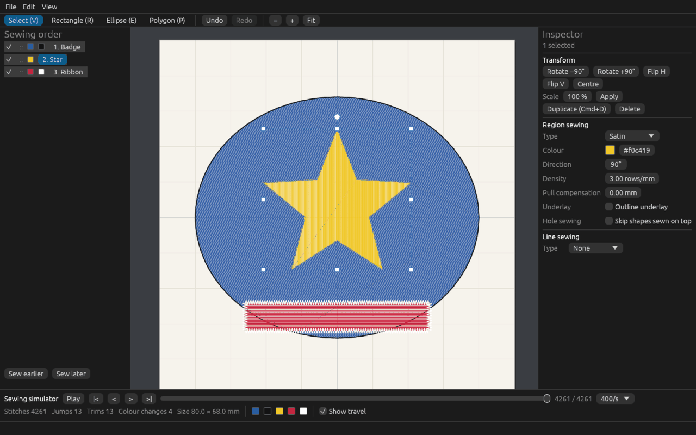
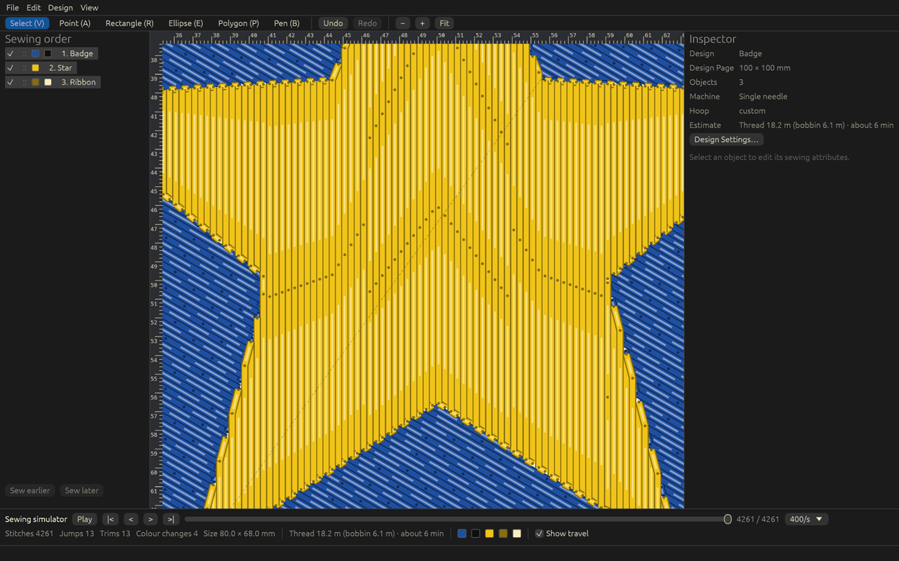
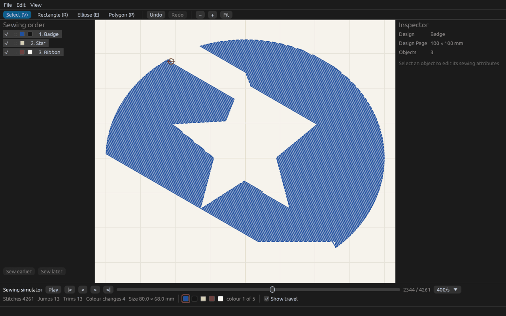
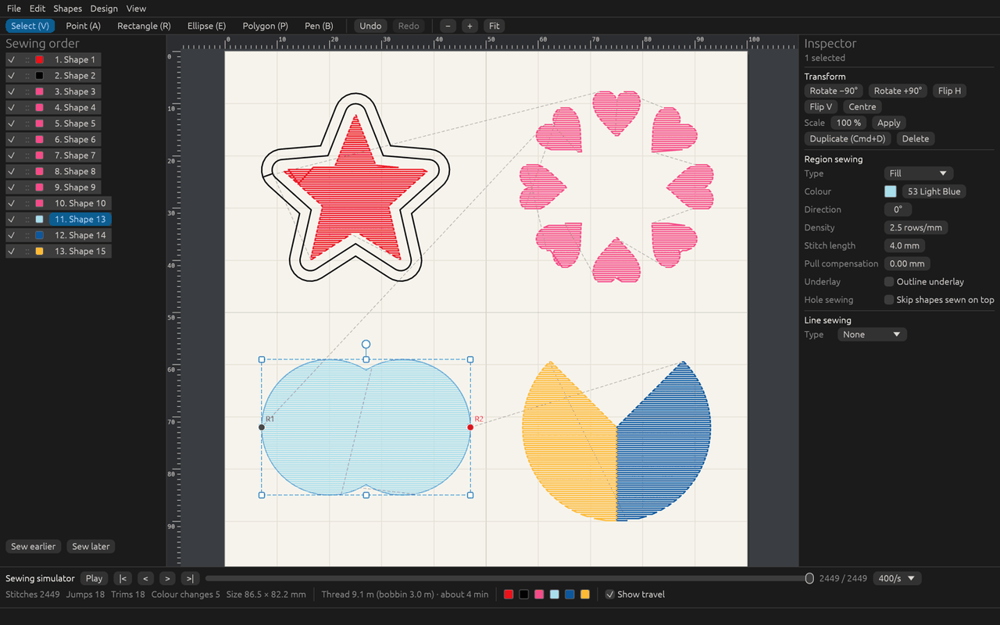
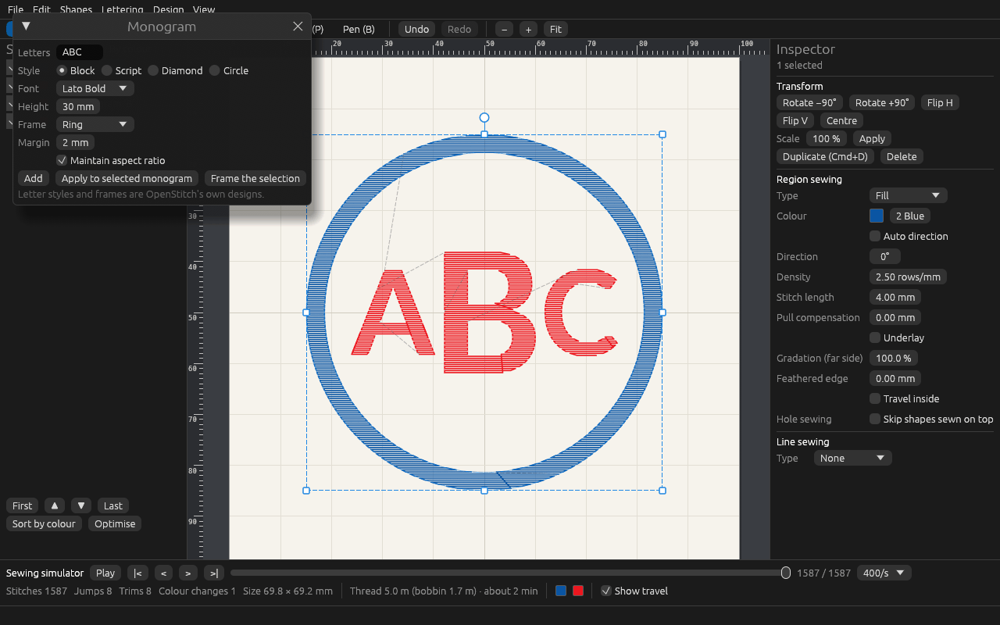
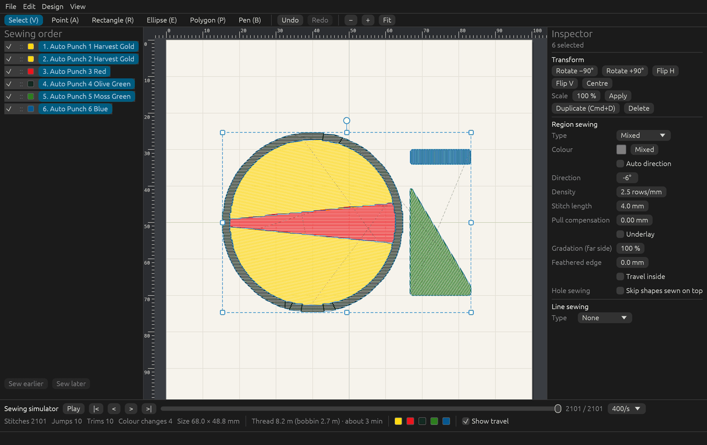
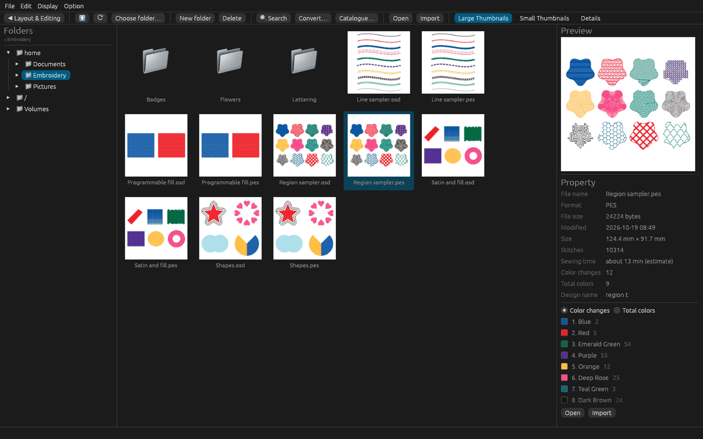
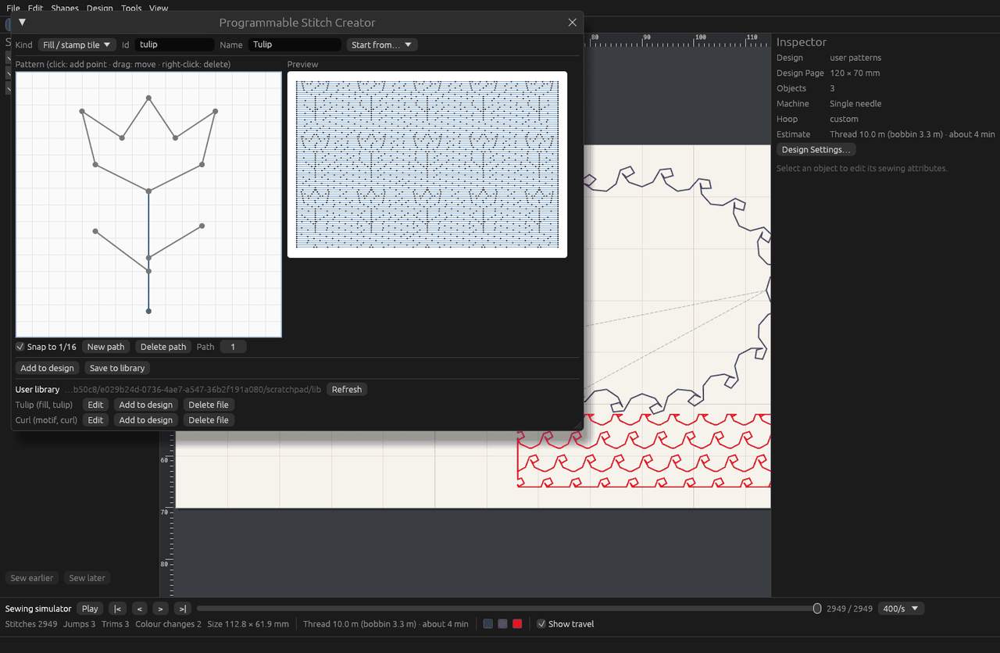

# OpenStitch

An independent, cross-platform (macOS, Windows, Linux) embroidery design application written in
Rust. It is built to be interoperable with Brother machines and with designs made in Brother
PE-DESIGN 11.

Not affiliated with Brother Industries. No Brother code or assets are included; see
[docs/LEGAL_AND_LICENSING.md](docs/LEGAL_AND_LICENSING.md).



## Screenshots

| | |
|---|---|
|  |  |
| **Realistic view:** see how the stitches will look on fabric. | **Stitch simulator:** play the design back stitch by stitch, with jumps and trims. |
|  |  |
| **Drawing and editing:** shapes, Bézier outlines, arranged copies and shape operations. | **Lettering:** text, monograms and frames with open-licence or your own fonts. |
|  |  |
| **Image to embroidery:** Auto Punch, Cross Stitch and Photo Stitch-style conversion. | **Design Database:** browse, search, organise and convert your design files. |
|  | |
| **Programmable Stitch Creator:** draw your own fill and motif stitch patterns. | |

## What it does today

- **Desktop editor** (`openstitch`):
  - drawing tools (rectangle, ellipse, polygon, arcs and preset shapes, Bézier pen, point editing)
  - selection and transforms, grouping, arranged copies
  - sewing attributes and sewing order
  - rulers, grid and measure tool
  - undo, stitch simulator and realistic preview
- **Stitches:**
  - fill, satin and running/triple
  - zigzag, motif, stem, candlewicking, E/V, chain and cutting lines
  - hole sewing and shape operations (merge, boolean, split, offset)
- **Lettering** with bundled open-licence fonts, including text on a path.
- **Image to embroidery:** Auto Punch-, Cross Stitch- and Photo Stitch-like conversion. These
  are independent approximations of PE-DESIGN's wizards.
- **Files:**
  - read/write: PES, PEC, DST, EXP, JEF, PCS, SEW, XXX, HUS, VIP
  - read only: SHV
  - editable `.osd` projects
- **Automation:** a scripting CLI (`stitchtool`) and an MCP server (`openstitch-mcp`). Both run
  the same commands as the editor.

See [docs/FEATURE_MATRIX.md](docs/FEATURE_MATRIX.md) for the full status of every feature and
how far it has been verified.

## Download a build

Every merge to `main` builds the executables for all three operating systems. Open the repository
on GitHub, go to **Actions → Rust workspace**, pick the latest run on `main` and download the
artifact for your system:

| Artifact | Contents |
|---|---|
| `openstitch-main-<sha>-macos-universal` | `OpenStitch-…-macos-universal.zip` (the `OpenStitch.app` editor, Apple Silicon and Intel) and `openstitch-cli-…tar.gz` (`stitchtool`, `openstitch-mcp`) |
| `openstitch-main-<sha>-windows-x86_64` | `OpenStitch-…-windows-x86_64.msi` (installer with `.osd`/`.pes` associations), a portable `.zip` of the editor, and `openstitch-cli-…zip` |
| `openstitch-main-<sha>-linux-x86_64` | `OpenStitch-…-linux-x86_64.tar.gz` (editor with `install.sh`, desktop entry and MIME types) and `openstitch-cli-…tar.gz` |

Details are in [docs/DISTRIBUTION.md](docs/DISTRIBUTION.md).

The builds are not code-signed yet:
- **macOS:** unzip and move `OpenStitch.app` to Applications, then right-click → Open the first
  time (or run `xattr -dr com.apple.quarantine OpenStitch.app`).
- **Windows:** choose *More info → Run anyway* in the SmartScreen prompt.

Official releases are published only when a version is declared stable (see
[Releases](#releases)).

## Build from source

### Prerequisites

- **Rust** 1.95 or newer via [rustup](https://rustup.rs):
  - macOS: `brew install rustup && rustup default stable`
  - Windows: install rustup-init and the "Desktop development with C++" build tools
  - Linux: the rustup installer from rustup.rs
- **Linux only, at run time:** the desktop libraries every X11/Wayland desktop already has
  (`libxkbcommon`, `libwayland-client` or `libX11`, and Vulkan or OpenGL drivers). Building needs
  no extra `-dev` packages.

### Build

```bash
git clone https://github.com/cristianonescu/OPE-Design11.git
cd OPE-Design11
cargo build --release
```

The binaries are written to `target/release/`: `openstitch` (the editor), `stitchtool` and
`openstitch-mcp` (`.exe` on Windows).

### Run

```bash
cargo run --release -p openstitch-app                   # the desktop editor
cargo run --release -p openstitch-app -- design.osd     # open a design or machine file
```

```bash
cargo run -p stitchtool -- exec examples/badge.json   # run a command script → badge.pes + badge.osd
cargo run -p stitchtool -- exec examples/heart.json   # Bézier example
cargo run -p stitchtool -- commands                   # list every command (JSON)
cargo run -p stitchtool -- serve                      # JSON-lines control channel on stdio
```

```bash
cargo run -p openstitch-mcp -- --root ~/Embroidery     # MCP server on stdio (see below)
```

A command script is a JSON array of `{"command": …, "params": {…}}` steps; see `examples/`.
Lengths are in millimetres and angles in degrees.

### Test

```bash
cargo fmt --all -- --check
cargo test --workspace
cargo clippy --workspace --all-targets -- -D warnings
```

CI runs the same checks on macOS, Windows and Linux for every pull request.

## MCP server (Claude Code and other MCP clients)

`openstitch-mcp` exposes every engine command as an MCP tool. It also adds `run_batch` (up to 256
commands at once) and `preview` (a PNG of the generated stitches). It talks JSON-RPC over stdio
and opens no network port.

File commands can only touch the directories you grant:
- `--root DIR` is read/write and `--read-root DIR` is read-only; both can be repeated.
- With no roots, every file command is refused.

Register it with Claude Code, from this checkout:

```bash
claude mcp add openstitch -- cargo run -q --release -p openstitch-mcp --manifest-path "$PWD/Cargo.toml" -- --root ~/Embroidery
```

or build once and register the binary (faster start-up, no cargo output on stdio):

```bash
cargo build --release -p openstitch-mcp
```

```bash
claude mcp add openstitch -- "$PWD/target/release/openstitch-mcp" --root ~/Embroidery --read-root ~/Documents/Designs
```

Then ask Claude, for example, to "make a 60 × 40 mm badge with a red satin border, preview it and
export badge.pes". `--read-only` blocks every editing command and `--no-files` blocks all file
access; run `openstitch-mcp --help` for these and the size-limit flags. Other
clients (Claude Desktop, IDEs) take the same command and arguments in their MCP server
configuration.

## Contributing

- Work on a branch and open a pull request to `main`; nobody pushes to `main` directly.
- A PR is merged once CI is green on all three operating systems.
- Every merge to `main` builds the executables (see [Download a build](#download-a-build)).
- Rules for the code (clean-room boundaries, command registry, golden tests) are in
  [docs/ARCHITECTURE.md](docs/ARCHITECTURE.md) and [docs/LEGAL_AND_LICENSING.md](docs/LEGAL_AND_LICENSING.md).

## Releases

Releases are made only when a version is declared stable:

1. Set `version` in the root `Cargo.toml` (for example `0.2.0`) through a normal pull request.
2. After it is merged, the maintainer tags that commit on `main`:

   ```bash
   git tag v0.2.0
   ```

   ```bash
   git push origin v0.2.0
   ```

3. The **Release** workflow checks that the tag matches the version and is on `main`, runs the
   full test suite, builds all three platforms and creates a **draft** GitHub release with the
   archives. Review the draft and publish it.

## Documents

- [Research log](docs/RESEARCH.md)
- [Architecture](docs/ARCHITECTURE.md)
- [Feature matrix](docs/FEATURE_MATRIX.md)
- [File formats](docs/FILE_FORMATS.md)
- [Compatibility tests](docs/COMPATIBILITY_TESTS.md)
- [Legal and licensing](docs/LEGAL_AND_LICENSING.md)
- [Roadmap](docs/ROADMAP.md)
- [Distribution and packaging](docs/DISTRIBUTION.md)
- [Reference VM plan](docs/VM_PLAN.md)
- [Handoff 2026-10-18: what is left](docs/HANDOFF-2026-10-18.md)

`tools/` holds the Python scripts that generate fixtures and data tables
(`pip install pyembroidery`, run with `python -I`).
