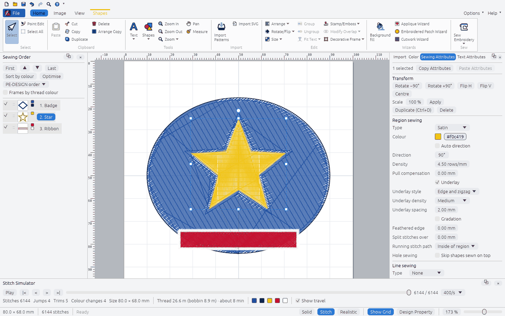

# Editor window layout

The OpenStitch editor arranges its commands the way the Layout & Editing window of Brother
PE-DESIGN 11 does, so people moving from it find each command where they expect it. The
arrangement, command names and workflow follow Brother's public online guide:
[Layout & Editing Window](https://support.brother.com/g/s/hf/htmldoc/ped/im/ped11/en/PED11_EN/pages/03_1245825.html),
[Ribbon menu tabs](https://support.brother.com/g/s/hf/htmldoc/ped/im/ped11/en/PED11_EN/pages/04_2156079.html)
and [Application button menu](https://support.brother.com/g/s/hf/htmldoc/ped/im/ped11/en/PED11_EN/pages/04_2152475.html).
Icons, colours and visual style are OpenStitch's own (see
[LEGAL_AND_LICENSING.md](LEGAL_AND_LICENSING.md#user-interface)).

| Guide element | OpenStitch |
|---|---|
| 1 Application button | **File** button at the top left: New, Open, Save, Save As, Print ▸, Design Property, Design Settings, Fabric Selector, Select Color Palette, Wizard ▸, Export ▸, Recent Files, Options, Exit ([screenshot](images/rust-editor-appmenu.png)) |
| 2 Ribbon | Tabs Home, Image, View plus contextual tabs (orange) for the active tool or selection; large and small buttons, dropdown arrows, group captions, ScreenTips with shortcuts |
| 3 Quick Access Toolbar | Above the ribbon (or below it, Options ▸ or ▾ ▸ Show below the Ribbon): New, Open, Save, Undo, Redo, Zoom, Help by default; ▾ adds or removes commands. Saved in `ui.json` next to the user settings file |
| 4 Option button | **Options ▾** at the top right: Design Database, Programmable Stitch Creator, Stitch Design Factory, Font Creator, Sewing Attribute Sets, User Thread Charts, colour theme (Light, Dark, System) |
| 5 Help button | **Help ▾**: instruction manual (this repository), keyboard shortcuts, About |
| 6 Sewing Order pane | Docked left: buttons at the top (sew first / earlier / later / last, sort by colour, optimise, frames by thread colour), one frame per object with a thumbnail and its thread colours; drag to reorder |
| 7 Import / Color / Sewing Attributes / Text Attributes | Docked right as four tabs |
| 8 Stitch Simulator pane | Docked under the work area |
| 9–10 Design Page, work area | White page on a grey work area (light theme) |
| 11 Status bar | Design size, stitch count, the ScreenTip of the command under the pointer or the active tool's hint |
| 12–15 View mode, Show grid, Design Property, zoom | Right of the status bar: Solid / Stitch / Realistic, Show Grid, Design Property, zoom percentage (type or drag) and zoom slider |

Panes 6, 7 and 8 are shown or hidden from View ▸ Show/Hide or their × button, and float as a
window (⧉) or dock again (⊟ Dock) ([screenshot](images/rust-editor-floating-panes.png)).

Commands OpenStitch does not implement yet are shown disabled, with a ScreenTip that says
"Not yet available in OpenStitch", rather than left out. The tables below are the model in
`crates/openstitch-app/src/editor/ribbon.rs`; `ribbon::tests` and the binary's
`ribbon::tests` check that every button runs an existing action or is marked unavailable, that
each engine command named exists, and that the contextual tabs follow the tool and selection.

## View, Image and Text commands

Behaviour follows the guide's pages
[Changing the display of the embroidery design](https://support.brother.com/g/s/hf/htmldoc/ped/im/ped11/en/PED11_EN/pages/04_2051337.html),
[Specifying Basic Display Settings](https://support.brother.com/g/s/hf/htmldoc/ped/im/ped11/en/PED11_EN/pages/03_1246217.html),
[Changing the size, angle and position of the image](https://support.brother.com/g/s/hf/htmldoc/ped/im/ped11/en/PED11_EN/pages/06_1804142.html),
[Saving the image data](https://support.brother.com/g/s/hf/htmldoc/ped/im/ped11/en/PED11_EN/pages/06_1804194.html),
[Setting text attributes](https://support.brother.com/g/s/hf/htmldoc/ped/im/ped11/en/PED11_EN/pages/05_1810676.html) (Font Filter) and
[Using Fabric Selector](https://support.brother.com/g/s/hf/htmldoc/ped/im/ped11/en/PED11_EN/pages/03_1246198.html).

- **Solid View** draws every stitch 0.7 mm wide without shading, so the rows of a region merge
  into flat areas of thread colour. Solid, Stitch and Realistic are exclusive (ribbon and status
  bar).
- **Realistic View Settings**: thread width (0.2–1 mm, default 0.4), contrast and brightness
  (−100–100), shown at once and kept in `ui.json`; Default restores them.
- **Show Grid with Axes**: on, the grid is drawn with solid lines; off, dotted.
- **Guideline** (also turns the rulers on): click or drag on the top ruler for a vertical
  guideline, on the left ruler for a horizontal one; drag its marker in the ruler to move it,
  click the × beside the marker (or drop it outside the canvas) to delete it. With Show Grid and
  Snap to Grid on, guidelines move in grid steps. The status bar shows the position while
  dragging. Up to 100 per ruler; they are saved in the `.osd` (`guides.set`, one Undo per
  change) and hidden when Ruler or Guideline is off.
- **Save Image** ▸ to File… writes the background image as shown (turned, cropped, colours
  adjusted) as PNG, BMP or JPEG (`background.save`); ▸ to Clipboard copies it.
- **Modify Image** opens a window with the image's position and width (the height keeps its
  proportions), a crop of each side (the kept part stays where it was, at the same scale),
  brightness, contrast and saturation; the image is outlined in red while the window is open.
  Each change is one `background.modify` (one Undo); the image file is never changed.
- **Rotate Right / Left** turn the background image 90° about its centre (`background.rotate`).
- **Font Filter Settings** lists the built-in fonts and the fonts in the design with check
  boxes (All / None per group, Default shows every font); OK turns the filter on. **Font
  Filter** switches filtering on and off; it applies to every font list. A filter that would
  hide every font is ignored. Both are kept in `ui.json`.
- **Fabric Selector** (Application menu): pick a fabric type to read a description and advice
  and see the recommended settings; OK applies them to every shape and text pattern on the
  Design Page, or, with the check box cleared, to the selected ones (`fabric.apply`, one Undo).
  It sets the density, stitch length, pull compensation and underlay of fill, programmable
  fill and satin regions; colours and sew types stay. The values are OpenStitch's own
  approximations (`openstitch_engine::fabric::FABRICS`), not PE-DESIGN's.

## Where the previous menus went

| Previous menu item | Now |
|---|---|
| File ▸ New, Open, Save, Save As, Print to PDF, Export, Quit | Application menu (Print ▸ Print to PDF, Export ▸, Exit) |
| File ▸ Import into design, Import SVG | Home ▸ Import |
| File ▸ Background Image (choose, paste, show/hide, opacity, remove) | Image ▸ Open Image, Paste Image, Background Image Density, Delete Image |
| File ▸ Export Sections, Send to USB Media | Home ▸ Sew ▸ Sew Embroidery; Hoop Settings tab; Application menu ▸ Export ▸ |
| File ▸ Design Database | Options ▸ Design Database |
| Edit ▸ Undo, Redo | Quick Access Toolbar (⌘/Ctrl+Z, ⌘/Ctrl+Y) |
| Edit ▸ Select All, Duplicate, Delete, Arrange Copies | Home ▸ Select, Clipboard |
| Edit ▸ Group, Ungroup | Home ▸ Edit |
| Edit ▸ Copy / Paste Attributes | Sewing Attributes pane |
| Edit ▸ Sewing Attribute Sets, User Thread Charts | Options ▸; Application menu ▸ Select Color Palette |
| Shapes ▸ Insert presets | Home ▸ Tools ▸ Shapes ▸ Insert Preset Shape |
| Shapes ▸ Merge, Remove Overlap, Combine | Home ▸ Edit ▸ Modify Overlap |
| Shapes ▸ Split with Outline, Sewing Direction, Entry/Exit Points | Shapes tab ▸ Split Outline, Add/Delete Direction Line, Center/Reference Point, Entry/Exit Points |
| Shapes ▸ Offset Lines, Floral Pattern | Shapes tab ▸ Create |
| Shapes ▸ Decorative Frame, Stamp/Emboss | Home ▸ Edit |
| Lettering ▸ Text, Monogram, Name Drop List, Template Wizard, Save as Template, Fonts, Load TrueType Font | Home ▸ Tools ▸ Text ▾ (and Text tab, Text Attributes pane) |
| Convert ▸ Convert to Stitch Pattern, Region to Line, to Outline/Blocks | Text, Shapes and Stitches tabs |
| Stitches ▸ Divide by Colour, Split at Point, Connect, Split Off Area | Stitches tab |
| Design ▸ Design Settings, Image to Embroidery, pattern wizards | Application menu ▸ Design Settings, Wizard ▸; Image tab; Home ▸ Wizards |
| Tools ▸ Programmable Stitch Creator, Stitch Design Factory | Options ▸ |
| View ▸ Fit, travel, realistic, rulers, grid, snap to grid, grid spacing, reference window, measure | Home ▸ Tools ▸ Zoom ▾, Measure; View tab |
| Toolbar tools and hints | Home ▸ Select / Tools, contextual tabs; hints in the status bar |

## Commands by tab

### Home

| Group | Command | Shortcut | OpenStitch action | Engine command | Available |
|---|---|---|---|---|---|
| Select | Select | `V` | `Action::SelectTool` | view/UI only | yes |
| Select | Point Edit | `A` | `Action::PointTool` | `object.setPoint` | yes |
| Select | Select All | `Ctrl+A` | `Action::SelectAll` | view/UI only | yes |
| Clipboard | Paste | `Ctrl+V` | `Action::Paste` | `object.duplicate` | yes |
| Clipboard | Cut | `Ctrl+X` | `Action::Cut` | view/UI only | **not yet** (disabled, ScreenTip says so) |
| Clipboard | Copy | `Ctrl+C` | `Action::Copy` | view/UI only | yes |
| Clipboard | Duplicate | `Ctrl+D` | `Action::Duplicate` | `object.duplicate` | yes |
| Clipboard | Delete | `Delete` | `Action::Delete` | `object.delete` | yes |
| Clipboard | Arrange Copy |  | `Action::ArrangeCopy` | `object.arrangeCopies` | yes |
| Tools | Text |  | `Action::TextTools` | `text.add` | yes |
| Tools | Shapes |  | `Action::ShapesTools` | `shape.preset` | yes |
| Tools | Zoom In | `Ctrl+=` | `Action::ZoomIn` | view/UI only | yes |
| Tools | Zoom Out | `Ctrl+-` | `Action::ZoomOut` | view/UI only | yes |
| Tools | Zoom | `Ctrl+0` | `Action::OtherZoom` | view/UI only | yes |
| Tools | Pan | `H` | `Action::Pan` | view/UI only | yes |
| Tools | Measure | `M` | `Action::Measure` | `design.measure` | yes |
| Import | Import Patterns | `Ctrl+Shift+I` | `Action::ImportPatterns` | `stitches.import` | yes |
| Import | Import SVG |  | `Action::ImportSvg` | `import.svg` | yes |
| Edit | Arrange |  | `Action::Arrange` | `order.move` | yes |
| Edit | Rotate/Flip |  | `Action::RotateFlip` | `object.rotate` | yes |
| Edit | Size |  | `Action::Size` | `object.scale` | yes |
| Edit | Group | `Ctrl+G` | `Action::Group` | `object.group` | yes |
| Edit | Ungroup | `Ctrl+Shift+G` | `Action::Ungroup` | `object.ungroup` | yes |
| Edit | Fit Text to outline |  | `Action::FitTextToOutline` | `text.setPath` | yes |
| Edit | Stamp/Emboss |  | `Action::StampEmboss` | `shape.emboss` | yes |
| Edit | Modify Overlap |  | `Action::ModifyOverlap` | `shape.combine` | yes |
| Edit | Decorative Frame |  | `Action::DecorativeFrame` | `shape.decorative` | yes |
| Wizards | Background fill |  | `Action::BackgroundFill` | `wizard.backgroundFill` | yes |
| Wizards | Applique Wizard |  | `Action::Applique` | `wizard.applique` | yes |
| Wizards | Embroidered Patch Wizard |  | `Action::Patch` | `wizard.patch` | yes |
| Wizards | Cutwork Wizard |  | `Action::Cutwork` | `wizard.cutwork` | yes |
| Sew | Sew Embroidery |  | `Action::SendEmbroidery` | `transfer.send` | yes |

### Image

| Group | Command | Shortcut | OpenStitch action | Engine command | Available |
|---|---|---|---|---|---|
| Image | Open Image |  | `Action::OpenImage` | `background.set` | yes |
| Image | Paste Image |  | `Action::PasteImage` | `background.set` | yes |
| Image | Save Image |  | `Action::SaveImage` | `background.save` | yes |
| Image | Modify Image |  | `Action::ModifyImage` | `background.modify` | yes |
| Image | Background Image Density |  | `Action::ImageDensity` | `background.show` | yes |
| Image | Rotate Right |  | `Action::ImageRotateRight` | `background.rotate` | yes |
| Image | Rotate Left |  | `Action::ImageRotateLeft` | `background.rotate` | yes |
| Image | Delete Image |  | `Action::DeleteImage` | `background.clear` | yes |
| Image to Stitch | Auto Punch Wizard |  | `Action::AutoPunch` | `digitize.autoPunch` | yes |
| Image to Stitch | Cross Stitch Wizard |  | `Action::CrossStitch` | `digitize.crossStitch` | yes |
| Image to Stitch | Photo Stitch 1 Wizard |  | `Action::PhotoStitch1` | `digitize.photoStitch` | yes |
| Image to Stitch | Photo Stitch 2 Wizard |  | `Action::PhotoStitch2` | `digitize.lineImage` | yes |
| Design Center | Import to Design Center |  | `Action::DesignCenter` | `digitize.designCenter` | yes |

### View

| Group | Command | Shortcut | OpenStitch action | Engine command | Available |
|---|---|---|---|---|---|
| View | Solid View |  | `Action::SolidView` | view/UI only | yes |
| View | Stitch View |  | `Action::StitchView` | view/UI only | yes |
| View | Realistic View |  | `Action::RealisticView` | view/UI only | yes |
| View | View Thread Trimming |  | `Action::ViewThreadTrimming` | view/UI only | yes |
| View | Realistic View Settings |  | `Action::RealisticSettings` | view/UI only | yes |
| Show/Hide | Sewing Order |  | `Action::PaneSewingOrder` | view/UI only | yes |
| Show/Hide | Stitch Simulator |  | `Action::PaneSimulator` | view/UI only | yes |
| Show/Hide | Attributes Setting |  | `Action::PaneAttributes` | view/UI only | yes |
| Show/Hide | Import Pane |  | `Action::PaneImport` | view/UI only | yes |
| Show/Hide | Reference Window |  | `Action::ReferenceWindow` | view/UI only | yes |
| Grid | Show Grid |  | `Action::ShowGrid` | view/UI only | yes |
| Grid | Show Grid with Axes |  | `Action::GridAxes` | view/UI only | yes |
| Grid | Snap to Grid |  | `Action::SnapToGrid` | view/UI only | yes |
| Grid | Grid Spacing |  | `Action::GridSpacing` | view/UI only | yes |
| Ruler | Ruler |  | `Action::Ruler` | view/UI only | yes |
| Guideline | Guideline |  | `Action::Guideline` | `guides.set` | yes |

### Text (contextual: text selected)

| Group | Command | Shortcut | OpenStitch action | Engine command | Available |
|---|---|---|---|---|---|
| Select | Select | `V` | `Action::SelectTool` | view/UI only | yes |
| Select | Point Edit | `A` | `Action::PointTool` | `object.setPoint` | yes |
| Select | Select All | `Ctrl+A` | `Action::SelectAll` | view/UI only | yes |
| Text | Text |  | `Action::TextTools` | `text.add` | yes |
| Text | Font |  | `Action::Font` | `object.setText` | yes |
| Text | Text Size |  | `Action::TextSize` | `object.setText` | yes |
| Text | Font Filter |  | `Action::FontFilter` | view/UI only | yes |
| Text | Font Filter Settings |  | `Action::FontFilterSettings` | view/UI only | yes |
| Text | TrueType Font Attribute Setting |  | `Action::TrueTypeAttributes` | `fonts.loadTrueType` | yes |
| Color / Sew Type | Line color |  | `Action::LineColor` | `object.setLine` | yes |
| Color / Sew Type | Line sew type |  | `Action::LineSewType` | `object.setLine` | yes |
| Color / Sew Type | Region color |  | `Action::RegionColor` | `object.setRegion` | yes |
| Color / Sew Type | Region sew type |  | `Action::RegionSewType` | `object.setRegion` | yes |
| Edit | Edit Text |  | `Action::EditText` | `object.setText` | yes |
| Edit | Fit Text to outline |  | `Action::FitTextToOutline` | `text.setPath` | yes |
| Edit | Convert to Blocks |  | `Action::ConvertToBlocks` | `object.toShapes` | yes |
| Edit | Convert to Stitches |  | `Action::ConvertToStitches` | `object.toStitches` | yes |
| Edit | Convert to Outline |  | `Action::ConvertToOutline` | `object.toShapes` | yes |

### Outline — Shapes (Outline) (contextual: Closed Straight Line / Closed Curve tool)

| Group | Command | Shortcut | OpenStitch action | Engine command | Available |
|---|---|---|---|---|---|
| Select | Select | `V` | `Action::SelectTool` | view/UI only | yes |
| Select | Point Edit | `A` | `Action::PointTool` | `object.setPoint` | yes |
| Select | Select All | `Ctrl+A` | `Action::SelectAll` | view/UI only | yes |
| Shapes | Closed Straight Line | `P` | `Action::ClosedStraight` | `shape.polygon` | yes |
| Shapes | Closed Curve | `B` | `Action::ClosedCurve` | `shape.path` | yes |
| Shapes | Pencil (Closed Curve) |  | `Action::PencilClosed` | view/UI only | **not yet** (disabled, ScreenTip says so) |
| Shapes | Open Straight Line |  | `Action::OpenStraight` | view/UI only | **not yet** (disabled, ScreenTip says so) |
| Shapes | Open Curve |  | `Action::OpenCurve` | `shape.path` | yes |
| Shapes | Pencil (Open Curve) |  | `Action::PencilOpen` | view/UI only | **not yet** (disabled, ScreenTip says so) |
| Color / Sew Type | Line color |  | `Action::LineColor` | `object.setLine` | yes |
| Color / Sew Type | Line sew type |  | `Action::LineSewType` | `object.setLine` | yes |
| Color / Sew Type | Region color |  | `Action::RegionColor` | `object.setRegion` | yes |
| Color / Sew Type | Region sew type |  | `Action::RegionSewType` | `object.setRegion` | yes |

### Outline — Shapes (Rectangle) (contextual: Rectangle tool)

| Group | Command | Shortcut | OpenStitch action | Engine command | Available |
|---|---|---|---|---|---|
| Select | Select | `V` | `Action::SelectTool` | view/UI only | yes |
| Select | Point Edit | `A` | `Action::PointTool` | `object.setPoint` | yes |
| Select | Select All | `Ctrl+A` | `Action::SelectAll` | view/UI only | yes |
| Shapes | Rectangle | `R` | `Action::Rectangle` | `shape.rectangle` | yes |
| Shapes | Edge radius |  | `Action::EdgeRadius` | view/UI only | **not yet** (disabled, ScreenTip says so) |
| Color / Sew Type | Line color |  | `Action::LineColor` | `object.setLine` | yes |
| Color / Sew Type | Line sew type |  | `Action::LineSewType` | `object.setLine` | yes |
| Color / Sew Type | Region color |  | `Action::RegionColor` | `object.setRegion` | yes |
| Color / Sew Type | Region sew type |  | `Action::RegionSewType` | `object.setRegion` | yes |

### Manual Punch (contextual: Manual Punch tool)

| Group | Command | Shortcut | OpenStitch action | Engine command | Available |
|---|---|---|---|---|---|
| Select | Select | `V` | `Action::SelectTool` | view/UI only | yes |
| Select | Point Edit | `A` | `Action::PointTool` | `object.setPoint` | yes |
| Select | Select All | `Ctrl+A` | `Action::SelectAll` | view/UI only | yes |
| Manual Punch | Straight Block | `U` | `Action::StraightBlock` | `shape.column` | yes |
| Manual Punch | Curved Block |  | `Action::CurvedBlock` | view/UI only | **not yet** (disabled, ScreenTip says so) |
| Manual Punch | Running |  | `Action::Running` | view/UI only | **not yet** (disabled, ScreenTip says so) |
| Manual Punch | Feed |  | `Action::Feed` | view/UI only | **not yet** (disabled, ScreenTip says so) |
| Color / Sew Type | Region color |  | `Action::RegionColor` | `object.setRegion` | yes |
| Color / Sew Type | Region sew type |  | `Action::RegionSewType` | `object.setRegion` | yes |

### Shapes — Shapes/Circle/Arc (contextual: shape selected, Circle or Point Edit tool)

| Group | Command | Shortcut | OpenStitch action | Engine command | Available |
|---|---|---|---|---|---|
| Select | Select | `V` | `Action::SelectTool` | view/UI only | yes |
| Select | Point Edit | `A` | `Action::PointTool` | `object.setPoint` | yes |
| Select | Select All | `Ctrl+A` | `Action::SelectAll` | view/UI only | yes |
| Edit Outline | Split Outline |  | `Action::SplitOutline` | `shape.split` | yes |
| Edit Outline | Add Direction Line |  | `Action::AddDirectionLine` | `object.setDirectionCurve` | yes |
| Edit Outline | Delete Direction Line |  | `Action::DeleteDirectionLine` | `object.setDirectionLines` | yes |
| Edit Outline | Reverse Direction Line |  | `Action::ReverseDirectionLine` | view/UI only | **not yet** (disabled, ScreenTip says so) |
| Edit Outline | Edit Point | `A` | `Action::EditPoint` | `object.setPoint` | yes |
| Edit Outline | Delete Point | `Delete` | `Action::DeletePoint` | `object.deletePoint` | yes |
| Edit Outline | Split at Point |  | `Action::SplitAtPoint` | `stitches.splitAt` | yes |
| Color / Sew Type | Line color |  | `Action::LineColor` | `object.setLine` | yes |
| Color / Sew Type | Line sew type |  | `Action::LineSewType` | `object.setLine` | yes |
| Color / Sew Type | Region color |  | `Action::RegionColor` | `object.setRegion` | yes |
| Color / Sew Type | Region sew type |  | `Action::RegionSewType` | `object.setRegion` | yes |
| Convert | Convert Region to Line |  | `Action::ConvertRegionToLine` | `object.regionToLine` | yes |
| Convert | Convert to Stitches |  | `Action::ConvertToStitches` | `object.toStitches` | yes |
| Create | Create Offset Lines |  | `Action::OffsetLines` | `shape.offsetLines` | yes |
| Create | Create Floral Pattern |  | `Action::FloralPattern` | `shape.floral` | yes |
| Create | Entry/Exit Points |  | `Action::EntryExit` | `object.setEntryExit` | yes |
| Create | Center/Reference Point |  | `Action::SewingPoints` | `object.setCenterPoint` | yes |

### Stitches (contextual: stitch pattern selected)

| Group | Command | Shortcut | OpenStitch action | Engine command | Available |
|---|---|---|---|---|---|
| Select | Select | `V` | `Action::SelectTool` | view/UI only | yes |
| Select | Point Edit | `A` | `Action::PointTool` | `object.setPoint` | yes |
| Select | Select All | `Ctrl+A` | `Action::SelectAll` | view/UI only | yes |
| Edit | Split Stitch Data |  | `Action::SplitStitchData` | `stitches.splitArea` | yes |
| Edit | Change Color |  | `Action::ChangeColor` | `threads.remap` | **not yet** (disabled, ScreenTip says so) |
| Edit | Divide by Color |  | `Action::DivideByColor` | `stitches.divideByColor` | yes |
| Edit | Split at Point |  | `Action::SplitAtPoint` | `stitches.splitAt` | yes |
| Edit | Connect |  | `Action::Connect` | `stitches.connect` | yes |
| Convert | Convert to Blocks |  | `Action::ConvertToBlocks` | `object.toShapes` | yes |
| Convert | Convert to Outline |  | `Action::ConvertToOutline` | `object.toShapes` | yes |
| Convert | Convert to Outlines |  | `Action::ConvertToOutlines` | `object.toShapes` | yes |

### Hoop Settings (contextual: design larger than the hoop)

| Group | Command | Shortcut | OpenStitch action | Engine command | Available |
|---|---|---|---|---|---|
| Select | Select | `V` | `Action::SelectTool` | view/UI only | yes |
| Select | Point Edit | `A` | `Action::PointTool` | `object.setPoint` | yes |
| Select | Select All | `Ctrl+A` | `Action::SelectAll` | view/UI only | yes |
| Hoop Settings | Move Sections |  | `Action::MoveSections` | view/UI only | **not yet** (disabled, ScreenTip says so) |
| Hoop Settings | Design Settings |  | `Action::DesignSettings` | `machine.set` | yes |
| Hoop Settings | Export Sections |  | `Action::ExportSections` | `sections.export` | yes |

### Application menu

| Command | Shortcut | OpenStitch action | Engine command | Available |
|---|---|---|---|---|
| New | `Ctrl+N` | `Action::New` | `design.new` | yes |
| Open | `Ctrl+O` | `Action::Open` | `project.open` | yes |
| Save | `Ctrl+S` | `Action::Save` | `project.save` | yes |
| Save As | `Ctrl+Shift+S` | `Action::SaveAs` | `project.save` | yes |
| Print |  | `Action::Print` | `design.print` | yes |
| Design Property |  | `Action::DesignProperty` | `design.info` | yes |
| Design Settings |  | `Action::DesignSettings` | `machine.set` | yes |
| Fabric Selector |  | `Action::FabricSelector` | `fabric.apply` | yes |
| Select Color Palette |  | `Action::SelectColorPalette` | `threads.charts` | yes |
| Wizard |  | `Action::Wizard` | view/UI only | yes |
| Export |  | `Action::Export` | `design.export` | yes |

### Option button

| Command | Shortcut | OpenStitch action | Engine command | Available |
|---|---|---|---|---|
| Design Database |  | `Action::DesignDatabase` | `library.list` | yes |
| Programmable Stitch Creator |  | `Action::StitchCreator` | `pattern.define` | yes |
| Stitch Design Factory |  | `Action::StitchDesignFactory` | `sewing.define` | yes |
| Font Creator |  | `Action::FontCreator` | `fonts.create` | yes |
| Sewing Attribute Sets |  | `Action::AttributeSets` | `attributes.save` | yes |
| User Thread Charts |  | `Action::UserThreadCharts` | `threads.createChart` | yes |

### Quick Access Toolbar (default)

| Command | Shortcut | OpenStitch action | Engine command | Available |
|---|---|---|---|---|
| New | `Ctrl+N` | `Action::New` | `design.new` | yes |
| Open | `Ctrl+O` | `Action::Open` | `project.open` | yes |
| Save | `Ctrl+S` | `Action::Save` | `project.save` | yes |
| Undo | `Ctrl+Z` | `Action::Undo` | `history.undo` | yes |
| Redo | `Ctrl+Y` | `Action::Redo` | `history.redo` | yes |
| Zoom | `Ctrl+0` | `Action::OtherZoom` | view/UI only | yes |
| Help |  | `Action::Help` | view/UI only | yes |
